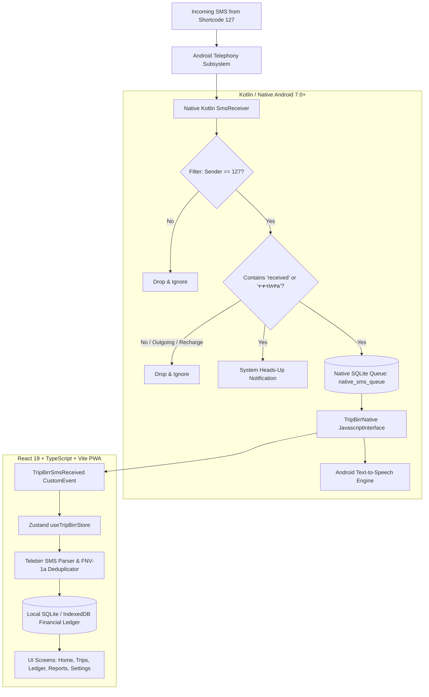

# TripBirr — Telebirr Driver Companion & Fare Ledger 🚕🇪🇹

[](LICENSE)
[](#architecture)
[](#tech-stack)
[-orange.svg)](#multilingual-support)
[](#building--running)
[](#zero-custody--offline-architecture)

> **TripBirr** is an offline-first companion application engineered specifically for Ethiopian drivers (minibus taxis, Lada taxis, bajaj, and ride-hailing operators). It automates the detection, validation, parsing, and attribution of incoming **Telebirr** passenger payments from Ethio Telecom's official sender shortcode **`127`**, seamlessly merging electronic and cash revenue into a structured financial ledger.

---

## 📖 The Problem & Context

Across Addis Ababa and Ethiopian metropolitan corridors, over 80% of urban commuters pay public transit and taxi fares using **Telebirr** (Ethio Telecom). Drivers operating high-frequency passenger routes face significant friction:

1. **Dangerous Driver Distraction**: Drivers must manually unlock their phones during stop-and-go traffic to read 4-line Telebirr confirmation text messages.
2. **Payment Fraud & Fake SMS**: Commuters sometimes display forged confirmation screenshots or spoofed SMS alerts.
3. **Fragmented Revenue**: Drivers collect both physical cash and electronic Telebirr payments, making end-of-shift reconciliation and vehicle fuel/association accounting tedious.
4. **Network Dropouts**: Cellular connectivity frequently drops along highway corridors or underground parking hubs, causing cloud-dependent apps to hang or lose state.

**TripBirr** solves this directly on the driver's device without requiring an active internet connection, third-party backend servers, or financial account credentials.

---

## ✨ Key Features

### 1. 🔔 Intelligent 127 SMS Detection & Voice Chime
* **Native Broadcast Interceptor**: Captures incoming Telebirr SMS messages directly via native Android `BroadcastReceiver` (`android.provider.Telephony.SMS_RECEIVED`).
* **Strict Filter for `127`**: Ignores all personal, OTP, and banking messages. Never reads personal chats.
* **Smart Inflow Verification**: Strictly checks for incoming payment markers (`received`, `reveived`, `credited with`, `ተቀብለዋል`). Outgoing transfers sent to others and airtime/package recharges (`recharge`, `የአየር ሰዓት`) are completely ignored.
* **Instant Voice Announcement (TTS)**: Plays an offline notification chime and speaks the fare aloud in real-time (*"Payment received: 50 birr from Natnael"*), allowing the driver to keep both eyes on the road.

### 2. 🚖 Active Trip Lifecycle & Corridor Association
* **One-Tap Trip Management**: Start and complete trips along known transit corridors (e.g. *Bole ⇄ Piassa*, *Mexico ⇄ Megenagna*, *Merkato ⇄ CMC*).
* **Automated Fare Attribution**: Payments received while a trip is active automatically link to that trip.
* **Unassigned Holding Bin**: Payments received between trips remain safely categorized in an unassigned ledger for manual review or one-click assignment.
* **Manual Cash Tracker**: Quick modal to record physical paper cash payments with preset quick-denominations (+10, +25, +50, +100 ETB).

### 3. 🗺️ Hybrid Road Routing (Addis Ababa Corridors)
* **Actual Road Corridors**: Routes snap to real Addis Ababa road geometry using OSRM with automatic fallback to an offline transit corridor coordinate graph.
* **Waypoint Corridors**: High-accuracy polylines connecting major transit hubs: *Bole Medhanialem*, *Meskel Square*, *Piassa*, *Mexico*, *Megenagna*, *Merkato*, *Kazanchis*, *4 Kilo*, *CMC Michael*, *Tor Hailoch*, *Gotera*, *Jemo*, and *Ayat*.

### 4. 🛡️ Privacy Shield & Balance Masking
* **Anti-Shoulder-Surfing**: Drivers operating around passengers can tap the **Eye Icon** in the top app bar to mask confidential shift revenue (`**** ETB`).
* **Selective Masking**: Masks total aggregate balances on the Home and Reports screens while leaving individual operational passenger payments visible for verification.
* **Phone Number Redaction**: Passenger phone numbers are automatically redacted (`2519****8747`) for passenger privacy.

### 5. 🌐 Full English & Amharic (አማርኛ) Localization
* Complete runtime language switching between English and Amharic.
* Every UI screen, modal, badge, button, and report heading is localized into formal, native Amharic.

### 6. 📊 Shift Analytics & One-Click CSV Export
* Daily and cumulative revenue breakdown (Total Revenue, Cash vs Telebirr split, average trip fare, highest trip).
* Daily target progress bar with celebratory achievement banners.
* 100% client-side **CSV export** for accounting, fleet owners, or tax records.

---

## 🏛️ System Architecture

TripBirr is architected with a decoupled, offline-first design combining a native Android Kotlin foundation with a high-performance React 19 / TypeScript single-page application hosted securely via Android `WebViewAssetLoader`.



### Data Pipeline & Deduplication Guarantees
1. **Deduplication Engine**: Every message is checked against existing unique Telebirr transaction IDs (e.g., `DJL25NAFRW`). If the transaction ID is truncated or omitted by the carrier, a deterministic fallback fingerprint is computed using `FNV-1a(senderId | amount | senderPhone | timestamp | body)`.
2. **Integer Minor Units**: All monetary values are parsed and stored as 64-bit integer minor units (Ethiopian Santim / cents, e.g., `5000` for `ETB 50.00`). This completely eliminates floating-point rounding errors and precision drift in financial calculations.
3. **Zero Custody Model**: TripBirr never asks for the user's Telebirr PIN, mobile banking password, or debit credentials. It reads only passive incoming notification broadcasts on the device.

---

## 📱 User Interface & Screens

| Screen | Description |
| :--- | :--- |
| **🏠 Home / Overview** | Daily target progress, live shift revenue (with privacy masking), one-tap start/end trip, and recent payments ordered by date. |
| **🚖 Trips** | Active and completed transit runs, passenger attribution lists, and interactive Leaflet map featuring hybrid road corridor tracing. |
| **💳 Transactions** | Searchable financial ledger with filters for Telebirr vs Cash, unassigned payments, and instant copy/verify tools. |
| **📈 Reports & CSV** | Daily and historical financial summaries, per-trip analytics, highest/lowest earnings, and one-tap CSV export. |
| **⚙️ Settings & Profile** | Language toggle (English / አማርኛ), Dark/Light mode, Driver & Vehicle information, audio/TTS settings, and SMS diagnostic logs. |

---

## 🛠️ Tech Stack

* **Frontend**: [React 19](https://react.dev/), [TypeScript 5](https://www.typescriptlang.org/), [Vite](https://vitejs.dev/), [Tailwind CSS 4](https://tailwindcss.com/)
* **State Management**: [Zustand 5](https://github.com/pmndrs/zustand) with local persistence
* **Icons & UI Elements**: [Lucide React](https://lucide.dev/), [Motion](https://motion.dev/)
* **Maps & Routing**: [Leaflet](https://leafletjs.com/), OpenStreetMap, OSRM road geometry engine
* **Native Android Wrapper**: Kotlin, AndroidX, `WebViewAssetLoader`, Android Text-to-Speech, SQLite3
* **Continuous Integration**: GitHub Actions automated Android APK compiler

---

## 🚀 Getting Started

### Prerequisites
* [Node.js](https://nodejs.org/) (v18 or higher)
* [npm](https://www.npmjs.com/) (v9 or higher)
* *(Optional for native Android build)*: [Android Studio](https://developer.android.com/studio) or Android SDK with JDK 17

### 1. Web Development & Testing

```bash
# Clone the repository
git clone https://github.com/localmaximumx/tripbirr.git
cd tripbirr

# Install dependencies
npm install

# Start local Vite development server
npm run dev

# Run TypeScript compilation check
npm run lint

# Run unit verification tests (SMS parsing, financial math, deduplication)
npx tsx -e "import { runAutomatedVerificationSuite } from './src/__tests__/smsAndDatabaseSuite'; console.log(runAutomatedVerificationSuite());"
```

### 2. Building the Web Bundle for Android

```bash
# Build production web bundle
npm run build

# Assets are copied into the native Android assets directory:
# react-native/android/app/src/main/assets/web/
```

### 3. Compiling the Android APK

You can build the Android APK directly using Gradle:

```bash
cd react-native/android

# On Linux / macOS:
./gradlew assembleRelease

# On Windows:
.\gradlew.bat assembleRelease
```

The resulting signed APK will be located at:
`react-native/android/app/build/outputs/apk/release/app-release.apk`

---

## 🔒 Security, Privacy & Android Permissions

TripBirr requests only the bare minimum Android permissions required to serve as a companion fare ledger:

| Permission | Purpose |
| :--- | :--- |
| `android.permission.RECEIVE_SMS` | Captures incoming passenger fare confirmation texts from shortcode `127`. Ignores all non-127 messages. |
| `android.permission.POST_NOTIFICATIONS` | Displays instant heads-up banners with passenger name and amount on Android 13+. |
| `android.permission.ACCESS_FINE_LOCATION` | Records start and end coordinates for trips (optional; manual Addis Ababa landmark selection is always available). |
| `android.permission.ACCESS_COARSE_LOCATION` | Approximate location for road corridor routing. |

> **Privacy Guarantee**: TripBirr has **zero telemetry, zero analytics tracking, and zero cloud uploads**. All trip records, passenger payment history, and profile data reside exclusively in local storage on the driver's phone.

---

## 📄 License

TripBirr is open-source software licensed under the **[Apache License 2.0](LICENSE)**.

```
Copyright 2026 TripBirr Contributors

Licensed under the Apache License, Version 2.0 (the "License");
you may not use this file except in compliance with the License.
You may obtain a copy of the License at

    http://www.apache.org/licenses/LICENSE-2.0
```

---

## ⚠️ Disclaimer

*TripBirr is an independent open-source project and is not affiliated with, endorsed by, or sponsored by Ethio Telecom or Telebirr. All trademarks, service marks, and company names are the property of their respective owners.*
